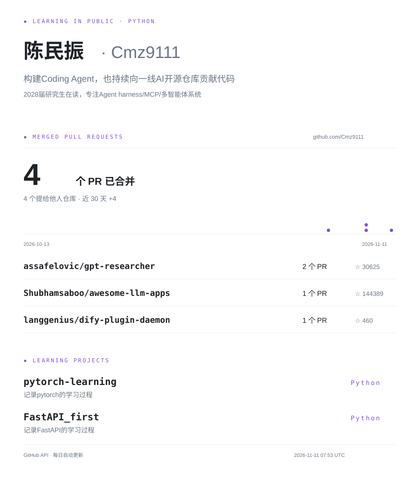

### 学习项目

- [pytorch-learning](https://github.com/Cmz9111/pytorch-learning) — 记录 PyTorch 的学习过程。
- [FastAPI_first](https://github.com/Cmz9111/FastAPI_first) — 记录 FastAPI 的学习过程。

[查看已合并的 PR](https://github.com/search?q=author%3ACmz9111+is%3Apr+is%3Amerged&type=pullrequests) · [查看所有仓库](https://github.com/Cmz9111?tab=repositories)

面板由 GitHub API 真实公开数据生成，每日更新。统计仅包含已合并 PR，不代表全部提交或学习活动。
